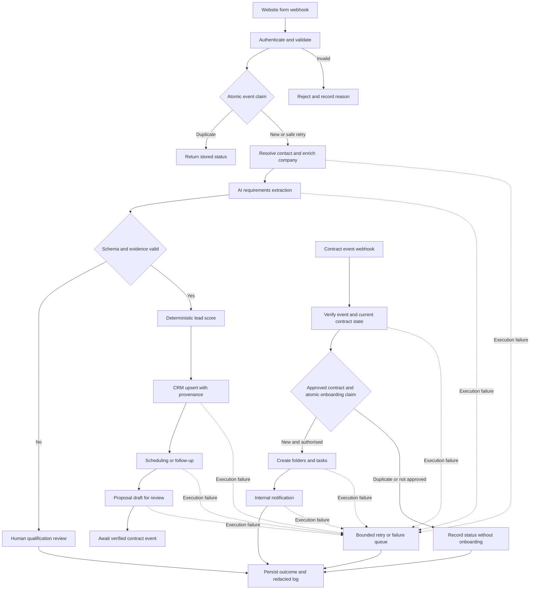

# AI Lead Qualification & Client Onboarding

| Development status | Scope |
| --- | --- |
| **Planned** | Proposed showcase; no workflow implementation or runtime results yet |

A planned event-driven workflow for qualifying agency enquiries, maintaining CRM records and starting onboarding after verified contract approval.

This repository contains a proposed technical case study. The business scenario is illustrative, not a completed client engagement. Integrations, exports, tests and demos are not available yet.

[GitHub profile](https://github.com/oleafm) · [Maintenance guide](docs/maintenance.md)

## Business problem

A digital agency receives website enquiries with inconsistent project details. Qualification, CRM updates, proposals and onboarding can become fragmented, especially when duplicate submissions or contract events arrive.

## Proposed solution

Use Make.com to normalise submissions, resolve contacts, enrich company information and extract requirements with AI. Versioned rules would score leads, while a separate verified contract event would authorise onboarding.

A lead score would prioritise agency follow-up; it would not approve a deal or authorise onboarding. Proposal generation would produce a draft. Only a verified contract event, the current provider-side contract state and the agreed business approval would permit project creation.

## Planned technology stack

| Role | Planned technology |
| --- | --- |
| Orchestration | Make.com |
| CRM | HubSpot or an equivalent CRM; selection pending |
| Requirements extraction | OpenAI API |
| Enrichment and integration | REST APIs; enrichment provider to be selected |
| Scheduling | Calendly |
| Documents | PandaDoc |
| Project assets | Google Drive; task and notification providers to be selected |

These tools describe the intended project stack, not completed integrations or an established commercial track record with every technology.

## Proposed architecture

All components and paths are proposed. The diagram summarises the main flow; validation and persistence failures would fail closed as described in the detailed design.

[Architecture decisions and data contracts](docs/architecture.md) · [Editable Mermaid source](diagrams/architecture.mmd)

## Planned workflow capabilities

1. Receive website form submissions through webhooks.
2. Validate and normalise incoming lead information.
3. Resolve existing contacts and prevent duplicate processing.
4. Enrich company information through an external API.
5. Extract project requirements with AI into a validated structure.
6. Apply configurable, deterministic scoring rules.
7. Create or update CRM records with field provenance.
8. Trigger meeting scheduling or follow-up workflows.
9. Generate proposal or document drafts for review.
10. Start onboarding after a verified, approved contract event.
11. Create project folders, tasks and internal notifications idempotently.

## Technical challenges to address

- Separating incomplete AI extraction from deterministic lead scoring.
- Resolving contacts without merging unrelated people or companies.
- Handling duplicate, delayed and out-of-order contract events.
- Recovering partial onboarding without duplicate folders, tasks or documents.

## Security and reliability considerations

Input validation, scoped credentials, idempotency, bounded retries and authenticated human review are planned requirements. Model output would remain untrusted until validated, and business rules would control downstream actions.

[Security boundaries and data handling](docs/security.md) · [Recovery and execution design](docs/architecture.md)

## Implementation progress

- [ ] Workflow implemented
- [ ] API connections configured
- [ ] Error handling implemented
- [ ] Synthetic test data prepared
- [ ] Tests executed
- [ ] Workflow export sanitised
- [ ] Architecture verified
- [ ] Demo video recorded
- [ ] Case study finalised

[Build sequence and open decisions](docs/implementation.md) · [Status definitions](docs/maintenance.md)

## Testing and evaluation

No workflow tests have been executed and no performance results are claimed. The [testing plan](docs/testing.md) defines synthetic cases, expected outcomes and evidence to collect once implementation exists.

## Demo and source files

| Artifact | Current availability |
| --- | --- |
| Demo video | **Placeholder — not recorded; add a real URL later** |
| Architecture | Proposed Mermaid above; [source](diagrams/architecture.mmd) |
| Workflow exports | None; [export instructions](workflows/README.md) |
| Prompts | None; [prompt plan](prompts/README.md) |
| Synthetic test data | Not prepared; [dataset plan](sample-data/README.md) |
| Screenshots | None; [evidence instructions](screenshots/README.md) |

## Future improvements

- Add versioned scoring configuration after business rules are agreed.
- Evaluate additional enrichment sources with recorded provenance.
- Extend reusable sub-scenarios after the first end-to-end path is tested.

Future ideas are outside the initial evidence claims and may change after the first implementation.
